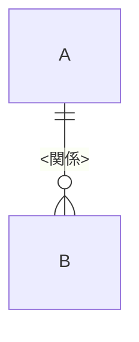

# 足す節 C：データ

入口：[AGENTS.md](../../AGENTS.md)　／　テンプレートの一覧：[templates/README.md](../README.md)

本体の仕様書：<本体の仕様書へのリンク>

<!-- 別の文書にしたときは、上の「本体の仕様書」に本体へのリンクを書き、「入口」のリンクを写した先に合わせて直す。 -->

<!-- 仕様書の 8 と 9 の間に入れるか、別の文書にして仕様書の文書一覧からリンクする。要件そのものは仕様書の 7・8 にだけ書き、ここからは要件 ID で参照する。当てはまらない項目は「該当なし（理由）」と書く。 -->

## C. データ

### C-1. エンティティと関係

| エンティティ | 役割 | 関係（相手と多重度） | 関わる要件 ID |
|---|---|---|---|
| | | | |

### C-2. 項目

エンティティごとに繰り返す。

#### <エンティティ名>

| 項目 | 型 | 必須 | 制約（一意、範囲、形式、初期値） | 説明 |
|---|---|---|---|---|
| | | | | |

### C-3. 保持期間と削除

| 対象 | 保持期間 | 削除の契機と方法 | 根拠・出典 |
|---|---|---|---|
| | | | |

### C-4. 移行

| 対象 | 移行元 | 変換の規則 | 確かめ方 | 戻し方 |
|---|---|---|---|---|
| | | | | |
